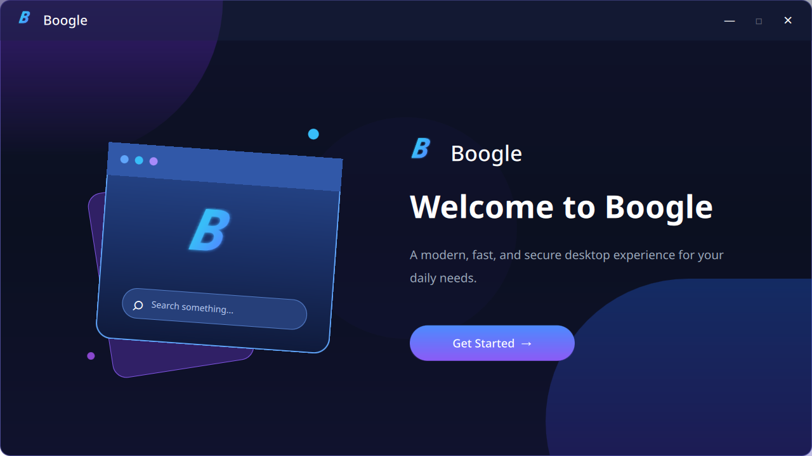
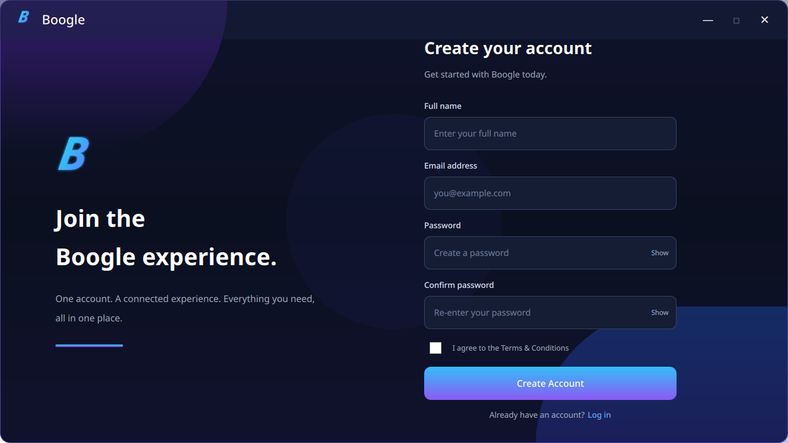
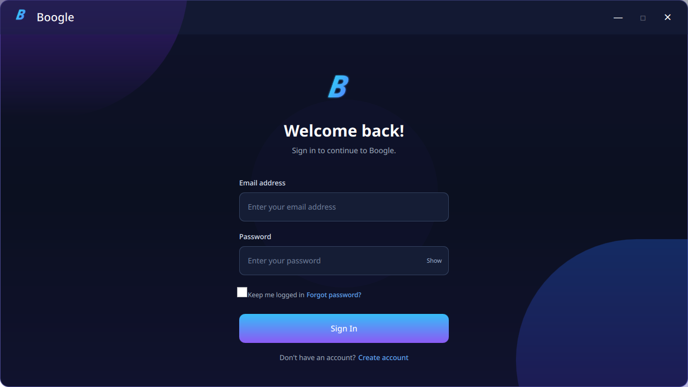
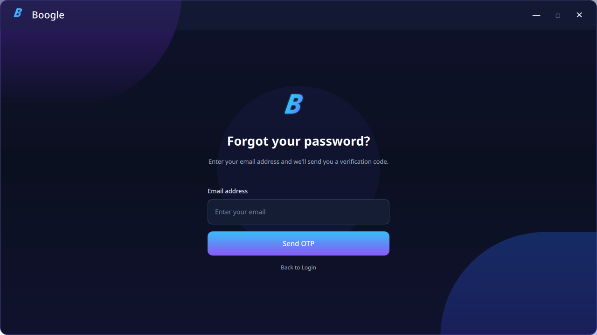

# Boogle

Boogle is an all-in-one desktop productivity application built with Python, PySide6, QML, FastAPI, and PostgreSQL.

## Tech Stack

- **Frontend:** PySide6, QML
- **Backend:** Python, FastAPI
- **Database:** PostgreSQL
- **ORM:** SQLAlchemy
- **Migrations:** Alembic
- **Authentication:** JWT, Argon2, Email OTP

## Screenshots

### Get Started


### Create Account


### Login


### Forgot Password


## Project Structure

```text
Boogle/
├── desktop/
│   ├── backend/
│   ├── qml/
│   ├── main.py
│   └── requirements.txt
├── server/
│   ├── app/
│   ├── migrations/
│   ├── alembic.ini
│   └── requirements.txt
├── pyproject.toml
└── README.md
```

## Setup

Clone the repository:

```bash
git clone https://github.com/psorigins10/Boogle.git
cd Boogle
```

Create and activate a virtual environment:

```bash
python -m venv .venv
source .venv/bin/activate
```

Install dependencies:

```bash
pip install -r server/requirements.txt
pip install -r desktop/requirements.txt
```

Configure the environment variables in `server/.env`.

## Run the Backend

```bash
cd server
uvicorn app.main:app --reload
```

API documentation:

```text
http://127.0.0.1:8000/docs
```

## Run the Desktop Application

From the project root:

```bash
python -m desktop.main
```

## License

See the [LICENSE](LICENSE) file for license information.
